  <picture>
    <source media="(prefers-color-scheme: dark)" srcset="assets/header-dark.svg">
    
  </picture>

  [`about-theo`](https://about-theo-kappa.vercel.app/) · [`velog`](https://velog.io/@seongm1n) · [`linkedin`](https://www.linkedin.com/in/hellotheo)

    

  <picture>
    <source media="(prefers-color-scheme: dark)" srcset="assets/terminal-dark.svg">
    
  </picture>

    

  <picture>
    <source media="(prefers-color-scheme: dark)" srcset="assets/contrib-dark.svg">
    
  </picture>

   

  <a href="https://www.acmicpc.net/user/sungmin9513">
    <picture>
      <source media="(prefers-color-scheme: dark)" srcset="assets/boj-dark.svg">
      
    </picture>
  </a>

